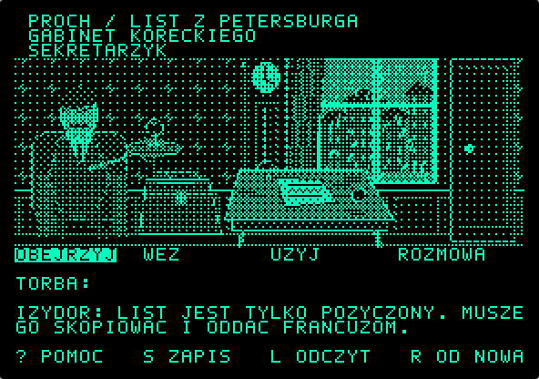

# PROCH — List z Petersburga

**Gra przygodowa na podstawie powieści „PROCH” Szymona Bromy.**
Pierwszy grywalny epizod: Warszawa, marzec 1898. Wciel się w Izydora Jelinka,
skopiuj poufny list o cenzurze i oddaj oryginał w stanie nienaruszonym.



## Pobierz i uruchom

Gotowy obraz: [dist/PROCH_EPIZOD_1.dsk](dist/PROCH_EPIZOD_1.dsk).
To prawdziwa dyskietka 5,25 cala: 35 ścieżek, 16 sektorów, 140 KiB,
**kolejność sektorów DOS**, z systemem plików ProDOS i programem 65C02.
Alternatywny plik `.po` zawiera tę samą dyskietkę w kolejności ProDOS.

Apple IIc z 128 KiB RAM i myszą lub enhanced Apple IIe z AppleMouse II.
W emulatorze wybierz enhanced IIe/IIc, włącz mysz (w IIe karta AppleMouse II,
np. slot 4), włóż `.dsk` do pierwszego napędu i wykonaj zimny start.
Gra uruchamia się sama; nie wpisuj RUN ani BRUN. Dla stylistyki ryciny
wybierz monitor monochromatyczny. Na fizycznym sprzęcie obraz należy
zapisać odpowiednim narzędziem Apple II — zwykłe kopiowanie pliku na dyskietkę nie wystarczy.

Kliknij czasownik i obiekt. Kliknięcie przedmiotu w torbie wybiera UZYJ;
następnie kliknij cel. Przejścia: sekretarzyk, drzwi i strzałka powrotu.
Teksty są po polsku bez znaków diakrytycznych. Własna czcionka pikselowa
5×7 w komórkach 7×8 jest wspólna dla interfejsu i plansz; litery mają pełne
białe piksele, bez wygładzania i rastrowania współczesnego fontu.

- `?` lub `H`: pomoc; kliknięcie opisu: kontekstowa podpowiedź.
- `S`: zapis na dyskietce; `L`: odczyt. Dyskietka musi pozwalać na zapis.
- `R`: nowa gra. `1`–`4`: wybór czasownika.
- Strzałki i Enter/spacja: sterowanie zastępcze bez myszy.

Zapis w emulatorze żyje w zmodyfikowanym obrazie napędu: **wyeksportuj go po grze**,
jeżeli emulator nie zachowuje dyskietek automatycznie. Oryginalny pobrany plik
nie zmienia się sam. Pracuj na kopii obrazu.

## Budowa

Wymagane Python 3 + Pillow i cc65. Repozytorium
zawiera wszystkie zasoby używane przez grę; build nie wymaga dostępu do PDF.

```sh
bash tools/setup.sh
bash tools/build.sh
```

`CC65_ROOT` domyślnie wskazuje `/workspace/tools/cc65`. Budowa odtwarza
ilustracje, kompiluje natywny program i tworzy świeże obrazy — nadpisuje pliki
dystrybucyjne, więc nie używaj ich do przechowywania jedynego zapisu rozgrywki.

[Założenia i zakres adaptacji](docs/ADAPTACJA.md) · [Solucja](docs/SOLUCJA.md) ·
[Informacje o komponentach](docs/THIRD_PARTY.md).
